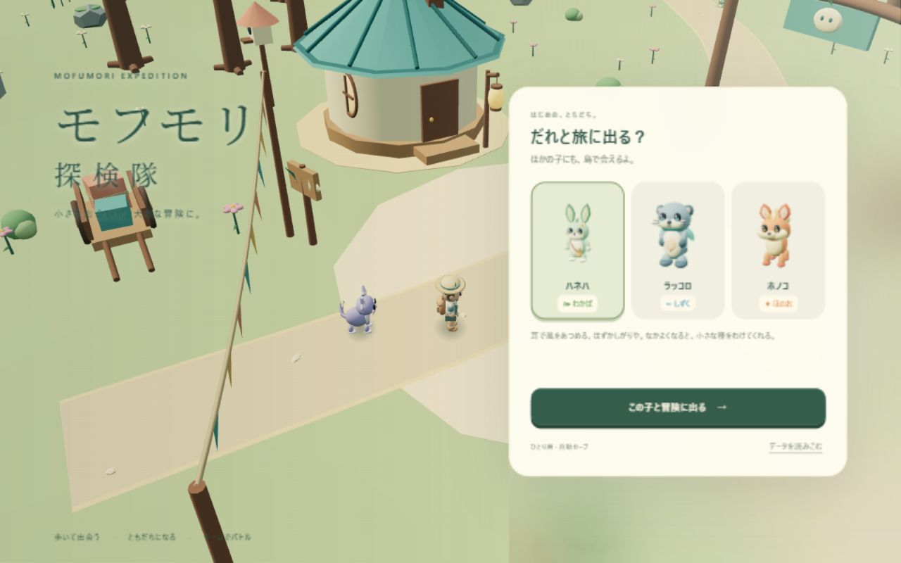
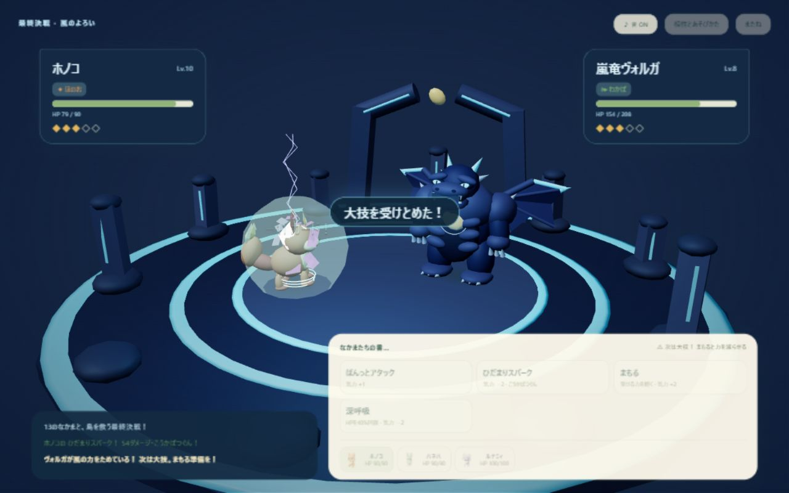

# モフモリ探検隊 / Mofumori Quest

丘・浜辺・灯りの森を歩き、13種類のオリジナルキャラクターと仲間になる、ひとり用の3Dアドベンチャーです。3体のチームを組んで守り手に挑戦し、三つのしるしの先にいる特別な友達を探します。



[配信版を開く](https://mofumori-quest.h-tanaka840330.chatgpt.site)（本人限定。ChatGPTへのログインが必要です）

## 遊びかた

- はじめにハネハ・ラッコロ・ホノコから相棒を選びます。ほかの相棒にも島で出会えます。
- PCはWASD / 矢印キー、Shiftで走る、ドラッグで見回す、ホイールでズーム。スマホは移動スティック。地面をクリック・タップしても歩けます。
- 近くでEキー、または「声をかける」。相手のHPを40%以下にすると必ず仲間になります。勝ってしまった場合も誘えます。
- 地図は未発見の地域や守り手へ道案内します。発見した道しるべへはすぐ移動できます。
- 仲間は攻撃型・防御型・回復型・相手の気力を減らす型に分かれます。ずかんから3体のチームを編成できます。
- 広場で無料回復。負けても仲間・しるしは失いません。
- 写真ボタンで景色とチームを記念写真に。ひとことを添えてPNGにできます。

## ローカルで起動

Node.js 24以上。外部パッケージのインストールやビルドは不要です。

```sh
npm start
```

ブラウザで http://127.0.0.1:4189/ を開きます。`dist/` はそのまま静的ホスティングへ配置できます。Three.js・フォントも同梱しており、CDNへの接続は不要です。

## セーブ

進行は同じ端末・ブラウザ・サイトのlocalStorageに自動保存されます。設定からJSONの書き出し・読み込みができます。読み込み前には置き換えるデータを確認します。クラウド同期はありません。ブラウザの保存データを消す前や端末を替える前にバックアップしてください。

## 開発と検証

`npm test` でNode標準テストを実行します。バトルの勝敗、相性、交代、仲間集め、全スターターの物語進行、セーブ検証、実際の島の経路、音の停止、モデルのカメラ内への収まりを対象にしています。ゲーム状態と戦闘処理は描画から分離し、決定的にテストできます。

| ファイル | 役割 |
| --- | --- |
| dist/catalog.js | キャラクター・地域・能力 |
| dist/game.js / battle.js | 進行・保存・ターン制バトル |
| dist/engine.js / navigation.js / framing.js | 3D表示・移動・カメラ |
| dist/creatures.js / keepers.js | オリジナルの立体キャラクター |
| dist/island.js / arena.js | 島と地域別の戦闘ステージ |
| dist/app.js / style.css | 日本語UI・入力・ダイアログ |
| dist/audio.js / postcard.js | 合成音楽・記念写真 |

WebGL2が必要です。PCと狭い縦画面で開発ブラウザを検証していますが、すべての実機スマートフォン・GPUの動作を保証するものではありません。重い場合は設定の「軽量表示」を選べます。オンライン対戦・課金・ガチャ・トラッキングはありません。

## クレジット

キャラクター・世界・音楽・UIはこのゲームのために作成したオリジナルです。既存ゲームのキャラクター・素材・ロゴは使用していません。第三者ライブラリとフォントは [THIRD_PARTY_NOTICES.md](THIRD_PARTY_NOTICES.md) を参照してください。

リポジトリの公開は閲覧用です。オリジナル部分の再利用ライセンスは別途指定していません。同梱ライブラリ・フォントには各ライセンスが適用されます。

## v1.1：図鑑完成から最終決戦へ

全13種類と三つのしるしがそろうと、嵐竜ヴォルガとのボス戦が解放されます。すでに図鑑を完成したv1セーブも引き継ぎ、再開後に解放演出が出ます。ボスは大技を予告し、HP半分で覚醒して属性が変化します。撃破すると専用の結末・称号・チーム回復があり、記念写真にも称号が残ります。

戦闘は属性ごとの3D軌跡・着弾・ダメージ表示・シールド・カメラ演出を追加。HP更新と効果音を着弾に同期し、ボスBGMは低音・打楽器・アルペジオを重ねます。音はプレイヤーがONにして開始。設定から音量と戦闘カメラ演出を調整できます。非表示や一時停止中は戦闘時計と音を止めます。


